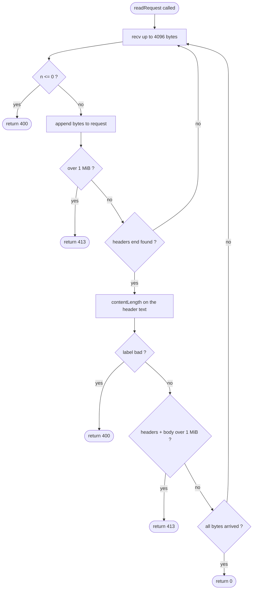

# 4.2 Read the whole request

> **Status:** done | **Area:** `src/server.cpp` | **Functions:** `contentLength()`, `readRequest()`, `handleClient()`

---

## What is happening

A client does not send a request in one piece. TCP is a **byte stream**, not a series of messages, so a request can arrive in several chunks. The old server called `read()` **once** (4096 bytes) and treated that as the whole request. Anything past the first chunk was lost.

The guide measured the damage: a 100 KB upload saved only **3,894 bytes**.

## Why it happens

`recv()` returns whatever has arrived **so far**, not the whole message. Big uploads, slow networks and split packets all mean the first `recv()` is only part of the request.

Analogy: a delivery guy hands you a big package in small boxes, one at a time. Opening the first box and saying "done" loses the rest.

## Key terms

### fd (file descriptor)

A small number the OS gives you for something you opened: a file, a socket, a pipe. Think of a cloakroom token: you hand over your coat, get token 5, and later ask for "token 5".

| fd | Meaning |
|---|---|
| 0 | stdin |
| 1 | stdout |
| 2 | stderr |
| 3+ | files and sockets you open (`server_fd`, `client_fd`) |

> [!WARNING]
> The OS gives each process a limited number of fds. Forgetting `close(fd)` leaks them, and eventually `accept()` fails.

### recv()

`recv(fd, buf, size, flags)` copies the bytes that have arrived on a connection into `buf`.

| Returns | Meaning |
|---|---|
| `n > 0` | got `n` bytes (possibly fewer than `size`) |
| `0` | the client closed the connection |
| `-1` | error, or the 5 s `SO_RCVTIMEO` timeout fired |

It **blocks** (waits) when nothing has arrived. That is why it must be called in a loop, and why the timeout matters.

### Content-Length

A header that labels the package: `Content-Length: 300000` means "300,000 body bytes follow". It tells the server when to stop collecting.

## What was done to prevent it

1. **Loop on `recv()`** until the header block ends (the blank line `\r\n\r\n`).
2. **Read the `Content-Length` label**, then keep receiving until headers + that many body bytes have arrived.
3. **Cap the request at 1 MiB.** Anything bigger gets `413`.
4. **Reject bad requests** (malformed label, closed early, timeout) with `400`.
5. **Set a 5 s receive timeout** (`SO_RCVTIMEO`) so an idle client cannot hold a thread forever.

| Situation | Response |
|---|---|
| Whole request arrived, size ok | continue to routing |
| `Content-Length` missing | treated as no body (0) |
| `Content-Length` malformed (`abc`, `-5`, empty) | `400 Bad Request` |
| Client closed early, or nothing for 5 s | `400 Bad Request` |
| Declared or actual size over 1 MiB | `413 Payload Too Large` |

## The two functions

| | `contentLength()` | `readRequest()` |
|---|---|---|
| **Job** | Reads the label: how many body bytes are coming? | Collects the whole request from the socket |
| **Input** | Header text it already has (a `string`) | The socket (`fd`), where data is still arriving |
| **Talks to the network?** | No, only looks at text | Yes, loops on `recv()` |
| **Returns** | `0` (no body), the size, or `-1` (bad label) | `0` (ok), `400`, or `413` |
| **Easy to test alone?** | Yes (text in, number out) | Needs a real connection |

Analogy: `readRequest` is the receiver at the door taking boxes. `contentLength` is the person who reads the label and says "20 boxes are coming". The receiver can't know when to stop without that answer.

### How `contentLength()` reads the label

- Lowercases a copy of the headers, because header names are case-insensitive.
- Finds `content-length:` and skips past the name to the value.
- Trims spaces and tabs around the value.
- Accepts only digits, at most 15 of them, so junk like `abc` or `-5` returns `-1` and the value always fits in a `long`.

## Flow of `readRequest()`



## Benefits of the fix

- Uploads of any size up to the cap arrive **intact**.
- Split packets and slow clients are handled correctly.
- Malformed and oversized requests get a clear `400` or `413`.
- A stuck client cannot hold a thread forever.
- Memory use per request is bounded.

## Losses if not fixed

- **Silent data corruption:** uploads are truncated and still answered `201`, so nobody notices.
- **Memory exhaustion:** a client declaring a huge body could eat all RAM.
- **Thread exhaustion:** idle connections pile up threads, and the server stops serving real users.
- **Hard to debug:** the failure depends on timing and packet size, so it looks random.

## How to test

### Build

```bash
cmake -B build -S . && cmake --build build
```

### Start the server

> [!NOTE]
> The port is still hard-coded to **4221**. `$PORT` support comes later. Note the space in `--directory /tmp/data`.

```bash
pkill http-server               # clear any old copy first
ss -ltnp | grep 4221            # expect no output
mkdir -p /tmp/data
./build/http-server --directory /tmp/data &
```

### Checks

- [x] **1. Normal request still works**
  ```bash
  curl -i localhost:4221/echo/hello          # expect 200
  ```
- [x] **2. 300 KB upload arrives intact**
  ```bash
  head -c 300000 /dev/urandom > /tmp/big.bin
  curl -s -X POST --data-binary @/tmp/big.bin localhost:4221/files/big.bin -o /dev/null -w "%{http_code}\n"   # expect 201
  wc -c /tmp/data/big.bin                    # expect 300000
  cmp /tmp/big.bin /tmp/data/big.bin         # no output = identical bytes
  ```
- [x] **3. Over the cap gives 413**
  ```bash
  head -c 2000000 /dev/urandom | curl -s -X POST --data-binary @- localhost:4221/files/huge.bin -o /dev/null -w "%{http_code}\n"   # expect 413
  ```
- [x] **4. Malformed `Content-Length` gives 400**
  ```bash
  exec 3<>/dev/tcp/localhost/4221
  printf 'POST /files/x HTTP/1.1\r\nContent-Length: abc\r\n\r\n' >&3
  head -n1 <&3; exec 3>&-                    # expect HTTP/1.1 400 Bad Request
  ```
- [x] **5. Idle client times out after about 5 s**
  ```bash
  time ( exec 3<>/dev/tcp/localhost/4221; head -n1 <&3 )   # expect 400 after ~5 s
  ```

### Clean up

```bash
pkill http-server
```

## Mistakes I hit

<details>
<summary>Click to expand</summary>

| Mistake | Symptom | Fix |
|---|---|---|
| `recv()` placed inside the `if` that returns | loop spins forever, never reads | `if` only returns; `recv` sits outside it |
| Leftover `read()` before `readRequest` | first bytes swallowed, request looked broken | delete the old `read()` |
| `*resp = "..."` and an `else` with no assignment | wrong pointer use, `resp` unset | `resp = "..."` in both branches |
| `SO_RCVTIME0` (zero) instead of `SO_RCVTIMEO` | compile error | the letter O, for "out" |
| `--directory/tmp/data` with no space | server failed to start | add the space |
| Old server still on port 4221 | `Failed to bind`, old code answered my tests | `pkill http-server` before starting |
| `curl -c -X POST` | `Could not resolve host: POST`, stray file `-X` | `-c` takes a filename, use `-s`; remove with `rm -- -X` |
| Tested with a 3 MB file | unexpected `413` | the cap is 1 MiB, use 300 KB for the success test |

</details>

## Known limits (not fixed here)

- `SO_RCVTIMEO` applies **per `recv()` call**, so a client sending one byte every few seconds can still hold a thread. A total deadline would fix it.
- Chunked bodies (`Transfer-Encoding: chunked`) are not supported, only `Content-Length`.
- Listen backlog is still 5, and the port is still fixed at 4221 (later steps).

## Remember

- TCP is a stream: one `recv()` is never guaranteed to be the whole message.
- `contentLength()` reads the label, `readRequest()` does the collecting.
- Always bound what a client can make you read (size cap) and how long you wait (timeout).
- Check which server is actually running before trusting a test result.
